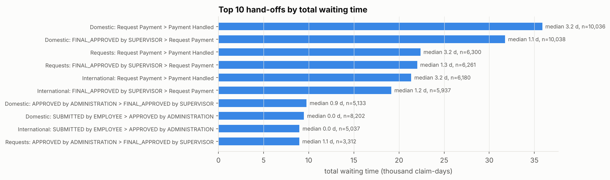
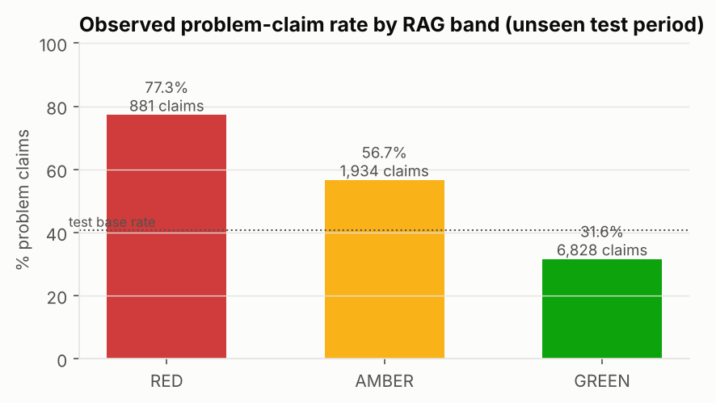

# ClaimPulse: process mining and early-warning analytics for reimbursement claims

ClaimPulse analyses **23,554 real reimbursement claims** from the BPI Challenge 2020 event logs (Eindhoven University of Technology travel and expense declarations, January 2017 to December 2018). The process is the same one that runs every claims operation: submit, review, approve, pay. The project builds:

- a governed DuckDB warehouse with bronze, silver and gold layers, data-quality rules with quarantine, and a provenance manifest
- operational KPIs and SLA tracking
- process mining with Celonis-style analysis in PM4Py: discovery, variants, bottlenecks and conformance
- an explainable early-warning model with a RED / AMBER / GREEN monitoring view
- a formula-driven Excel KPI pack
- a Power BI star schema with DAX measures

**Every number in this README is rendered from `outputs/audit/audit.json`**, which the pipeline writes as it runs. A test fails if any number here does not trace back to that record.

> Honest scope: these are university expense claims, not insurance or healthcare claims. The operational logic transfers: intake, multi-level review, rework loops, payment runs and SLA management. The domain does not. See [Limitations](#limitations).

## Headline findings

**1. Payment, not approval, drives cycle time.** The median claim reaches final approval in 2.0 days, then waits 5.4 more days to be paid. 51.8% of all waiting time between steps occurs *after* final approval. The cause is visible in the timestamps: 99.6% of 22,537 payments are handled on Thursdays and Mondays, and 98.7% at 17:00. That is a twice-weekly batch payment run, so a claim approved just after a run waits for the next one.



**2. Rework is concentrated in one review step and slows claims down.** 16.7% of claims are rejected at least once by a reviewer, and 12.9% are resubmitted. Administration accounts for 73.1% of all rejections. Paid claims that were rejected along the way have a median cycle of 15.1 days, against 8.0 days for claims never rejected. Zero-amount claims are a clear quality signal: 513 claims carry a zero amount, and 97.5% of them become problem claims (96.3% are never paid).

**3. SLA performance varies widely by unit.** Against an analytical 14-day SLA from submission to payment, 25.6% of paid claims breach. The rate is 20.1% for domestic, 34.3% for international and 25.7% for requests for payment. Across the 27 unit and log combinations with at least 50 claims, the breach rate runs from 13.0% to 54.7%. The worst month was August 2018 for International declarations, at 48.9%.

**4. The documented approval path is not the norm everywhere.** 66.0% of claims follow the intended approval process exactly; for international declarations the figure is 57.5%. Two compliance gaps stand out:
- 17.5% of international claims had the travel permit approved only *after* the trip started.
- 5.0% were declared more than 60 days after the trip ended.

On the review side, 14.1% of paid domestic claims show no recorded administration or pre-approver check.

**5. Early warning is useful for triage, not for decisions.** A LightGBM model scores each claim at first submission. On an unseen later period it reaches ROC AUC **0.694** (95.0% bootstrap CI 0.683 to 0.704). For comparison, a log-type-only baseline scores 0.594 and logistic regression scores 0.641. In the monitoring view:
- RED claims (9.1% of volume) turn into problem claims 77.3% of the time.
- GREEN claims do so 31.6% of the time.
- RED and AMBER together capture 45.2% of all problems.

The model's main drivers, by SHAP, are: Claim amount (log); Submission month; Org unit: claims closed in prior 180 days (log).



## What is in the repo

| Step | What it does | Main outputs |
|---|---|---|
| 1 Data layer | Streams the three XES logs into DuckDB bronze (lossless), silver (typed, rule-checked) and gold (one row per claim plus hand-offs). Verifies MD5 against the 4TU landing pages and case and event counts against the published figures. | `outputs/audit/manifest.json`, `outputs/kpis/dq_rule_results.csv` |
| 2 KPIs | Volume, paid rate, rejection, resubmission, first time right, cycle time, SLA breach, by log, month, year, reviewing role, org unit and budget | `outputs/kpis/*.csv`, `outputs/figures/kpi_*.png` |
| 3 Process mining | Variants, inductive-miner discovery, waiting time per hand-off, payment batch profile, alignment conformance against the intended process, business compliance rules | `outputs/mining/*`, `outputs/figures/pm_*.png` |
| 4 Early warning | Point-in-time features, temporal train / validation / test split, LightGBM with baselines, isotonic calibration, SHAP, RAG bands | `outputs/model/*`, `outputs/figures/model_*.png` |
| 5 Excel and Power BI | Formula-driven KPI pack (dropdown, editable SLA, RAG formatting, charts); star schema CSVs with DAX measures | `outputs/excel/ClaimPulse_KPI_Pack.xlsx`, `outputs/powerbi/`, `docs/powerbi_build_guide.md` |
| 6 Docs | README, methodology, reporting requirements and Power BI guide, all rendered from the audit record | `templates/`, `docs/` |
| 7 Tests | Data contracts, metric recomputation, doc traceability with a mutation check, no-dash and no-raw-data guards | `tests/` |

Data quality summary:
- Bronze holds 23,835 cases and 165,384 events.
- 281 cases were quarantined because they have no employee submission, and 15 duplicate events were removed.
- Gold holds 23,554 claims.
- All three source files match their published MD5 and published counts.

## Run it

```bash
pip install -r requirements.txt
# put the three .xes.gz files in data/raw/ (see data/README.md)
PYTHONPATH=src python -m claimpulse.pipeline
PYTHONPATH=src pytest -q
```

The full pipeline is deterministic and rebuilds every output and document from the raw logs.

## Data and licence

Source: van Dongen, B. (2020), *BPI Challenge 2020*, 4TU.ResearchData, [doi:10.4121/uuid:52fb97d4-4588-43c9-9d04-3604d4613b51](https://doi.org/10.4121/uuid:52fb97d4-4588-43c9-9d04-3604d4613b51). Logs used:
- Domestic Declarations (10,500 cases)
- International Declarations (6,449 cases)
- Request For Payment (6,886 cases)

The data is licensed **CC BY-NC 4.0** (attribution, non-commercial). Raw logs are not redistributed here. Derived outputs are shared under the same terms. Code is MIT licensed.

## Limitations

- **Domain.** University travel and expense claims, not insurance or healthcare claims. Amounts are as published and are not interpreted as euros.
- **No real SLA.** The 14-day SLA is an analytical choice: 79.9% of paid domestic claims finish within it. Sensitivity results at 7, 14, 21 and 30 days are in `outputs/kpis/sla_sensitivity.csv`.
- **Anonymised resources.** Every person appears as `STAFF MEMBER`, so the analysis works at role level and cannot measure individual workload.
- **Scope change.** 2017 covers two departments and 2018 the whole university. Volume trends across that boundary reflect scope, not demand.
- **No org unit for domestic claims.** Domestic declarations carry only a budget number, so the org-unit scorecard covers international declarations and requests for payment.
- **Model drift.** The problem rate rises from 27.6% in training to 40.8% in the test period, so calibrated probabilities under-predict in test. The RAG bands rank correctly but should be recalibrated before any live use.

Full detail: [docs/methodology.md](docs/methodology.md) and [docs/reporting_requirements.md](docs/reporting_requirements.md).
